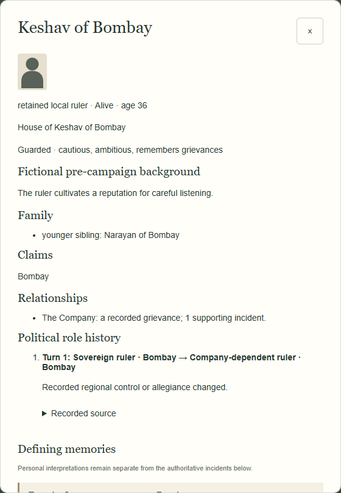
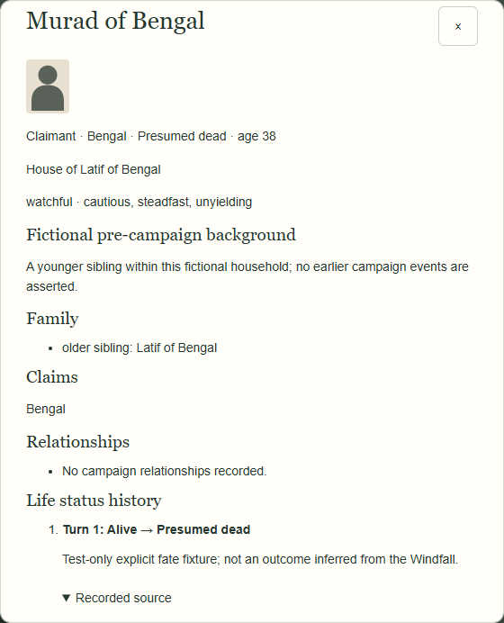

# Character Engine Milestone 1 — small demonstration

## Unchanged campaign, actual role change

The existing 23 characters and eight seats remain. In the fixed-seed browser campaign, **Keshav of Bombay** (`ruler-bombay`) starts as the same sovereign ruler with the same younger sibling, Narayan. An actual successful Bombay Army deployment changes Company control through the existing resolver. Keshav remains the same **Alive** person; his existing position reads *retained local ruler*. His new political history records:

> Turn 1: Sovereign ruler · Bombay → Company-dependent ruler · Bombay

The source expands to the actual `deploy` incident. There is **no life-status transition**, death, exile, imprisonment, new person or automatic succession. Undo restores the complete old person/history and board; Redo restores the exact committed record. No earlier role episodes are backfilled into old saves.

## Six manually constructed statuses — test fixtures only

These records are explicitly constructed in `tests/character-engine-fixtures.js`. **They are not gameplay-generated fates or campaign writing.** A manually triggered Windfall supplies a real test parent/source container solely to exercise reference validation; it does not cause anyone's disappearance, imprisonment or death. Test reasons state this explicitly. Claimants and their claims are manually constructed too. All original active rulers and 23 IDs remain in place.

| Original character ID | Public status | Meaning shown |
|---|---|---|
| `heir-punjab` | Alive | Existing living family member |
| `heir-delhi` | Exiled | Known survivor; test-only claimant, not current ruler |
| `heir-bengal` | Presumed dead | Unresolved fate; test-only claimant, no secret survival choice |
| `heir-bombay` | Confirmed dead | Confirmed final death; no return |
| `heir-maratha` | Missing | Unknown whereabouts; distinct from presumed dead |
| `heir-hyderabad` | Imprisoned | Known living captive; no automatic restoration |

Opening the presumed-dead dossier shows **Murad of Bengal**, **Presumed dead**, the test-only prior-to-current transition and its recorded source. It offers no return prediction or secret survival flag. His original older-sibling link remains. Existing search finds “Presumed dead”; there is no new fate/succession control. JSON import/export and snapshots retain these exact explicit records.

Reproduce against an isolated local app: `node scripts/check-character-engine-browser.cjs`. The fixed seed and synthetic fixtures are reproducible; no personal campaigns or hosted Site were touched. All six statuses are exercised in standard and quiet mode in regular and Debug at 1440×900 and 1024×768. No creative approval of a future fate-generation experience is implied.
