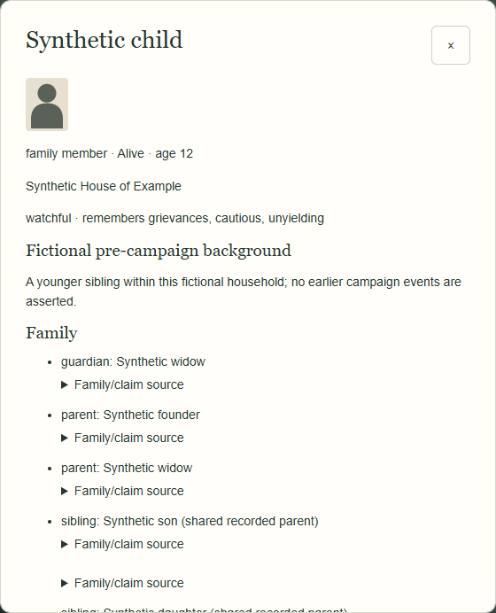
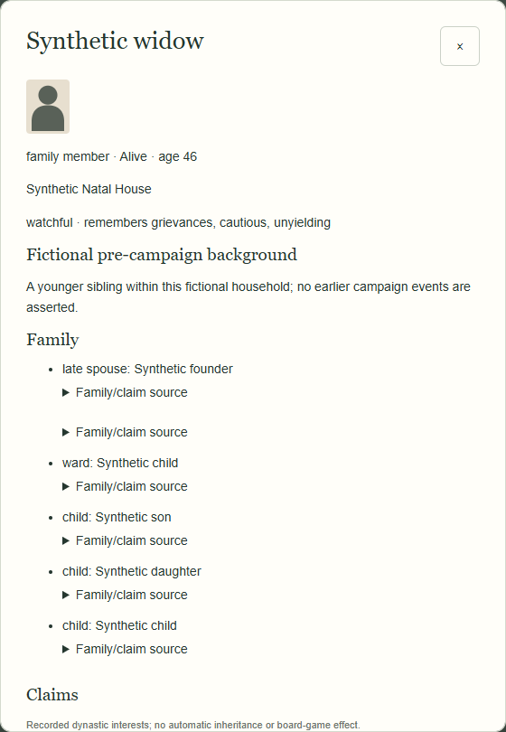

# Milestone 2A — small family/claims demonstration

## Existing family: unchanged

In the fixed-seed existing campaign, **Rashid of Delhi** (`ruler-delhi`) still has the same **younger sibling, Hamid of Delhi** (`heir-delhi`). There are exactly **23 characters**, no typed parent/marriage records, and no designated successor. The old house text is not treated as proof of ancestors. Opening the dossier changes nothing. Old current-version JSON remains unchanged on import/export.

## Synthetic dynasty: fixtures only

`tests/character-family-fixtures.js` adds **eight explicitly introduced test identities** to demonstrate 31 records. These are not generated during play, not a new production dynasty, and not approved fictional campaign events. All original 23 people and eight active seats remain untouched. Two manually triggered Windfalls provide canonical test source containers; **they do not cause the synthetic death, marriage, adoption, birth or claim**. Every test origin says so.

The synthetic founder and widow have three recorded biological children. The founder also has an explicitly adopted child and an explicitly known sibling/rival. The widow is the child's recorded guardian. A separate ended marriage demonstrates former spouses. Confirmed death and the recorded marriage ending establish widowhood; presumed death would be rejected as proof.

| Test person | Recorded connection / claim | Future context only |
|---|---|---|
| Synthetic son, 22 | Recognised designation | Available adult; no successor selected |
| Synthetic daughter, 19 | Recognised parentage claim via founder | Available adult; no gender-derived ranking |
| Synthetic child, 12 | Recognised parentage claim | Would need an eligible regent |
| Synthetic adopted, 16 | Contested adoption claim | Child; adoption and prior claim inspectable |
| Synthetic widow, 46 | Contested marriage-derived claim; guardian | Authored woman; retains natal and marital-house records |
| Synthetic rival, 38 | Dormant, contested witnessed-authority claim | Recorded assertion → dormant history |
| Synthetic founder, confirmed dead | Previous-rulership claim | Not an available successor; never revived |

The widow retains her **Synthetic Natal House** identity after marriage into the **Synthetic House of Example**. Her name, ID and natal affiliation are not replaced. Removing her explicit claim leaves the marriage record intact but no claim in succession context. Marriage alone grants no throne or territory.

The child's dossier shows parent/guardian/sibling links, the actual parentage edge and `founder-claim` supporting its asserted claim. Delhi remains occupied by the original `ruler-delhi`; none of these people is installed. There is no family-management or successor-choice control.

## Restoration and actual gameplay

Browser checks compare the complete state before/after reading/searching, across reload, JSON download/import and snapshot restore. A separate **real Army conquest** in the original 23-person campaign records only the existing M1 role change: the same local ruler becomes Company-dependent. It creates no marriage, child, claim, death or successor. Undo and Redo restore exact board/character/history state. Test-fixture full save frames also restore every typed link and claim exactly.

Reproduce against an isolated local server: `node scripts/check-family-browser.cjs`. Checks run at **1440×900** and **1024×768**, regular/Debug, standard/quiet/Normal. No personal save or hosted Site was modified. This demonstrates data and presentation foundations, not an active succession experience.
