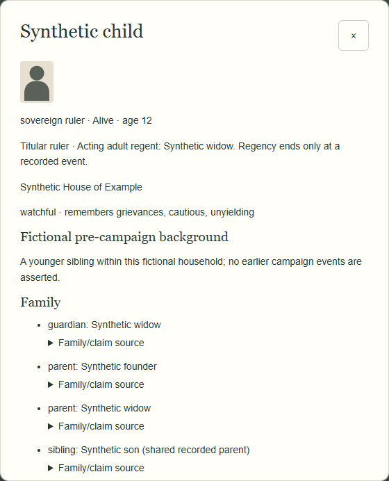
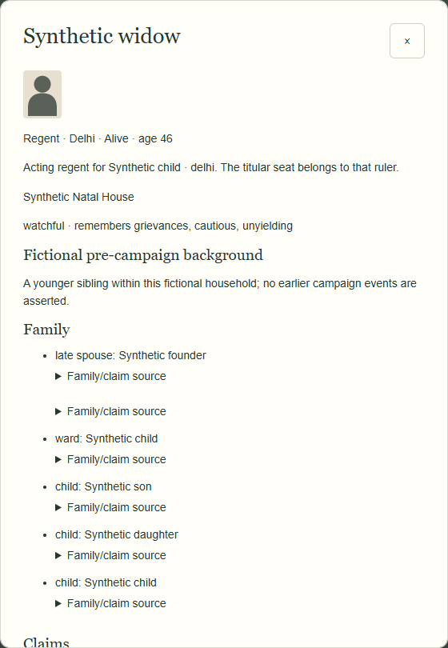

# M2B-1 — controlled synthetic demonstrations

**TEST OUTPUT ONLY.** These use the existing M2A synthetic dynasty: original 23 actors plus eight explicitly introduced fixtures. They do not generate replacements or change the live setup. M2A's manual Windfalls are source containers for explicitly declared test family data, not causes of marriages, deaths or children. Succession itself gets a separate canonical **SYNTHETIC TEST** event.

Run: `node scripts/demo-succession.mjs` (optional second argument: output JSON path). The [saved summary](review/character-engine-m2b1/demonstration.json) gives policy, evidence and explicit rejection reasons.

| Case | Input / decision | Recorded result |
|---|---|---|
| Adult designation | Test policy prioritises actual recognised designation | `demo-son` replaces `ruler-delhi`; abdication leaves the old ruler alive, with a dormant claim |
| Disputed adults | Default decision is ambiguous; explicit controlled choice of `demo-daughter` | Daughter installed; rival retains the same contested/dormant claim and unchanged relationships—no invented feud |
| Minor with guardian | Explicit child claim + `demo-widow`'s recorded guardianship | `demo-child`, age 12, is titular ruler; widow, age 46, is a separate acting regent |
| Regent ending | Two staged valid New Turns take age 12 → 15 → 18 | Regency remains active until a separate `test-regency-end` event; then prior adult role/position restored |
| Vassal | Bombay fixture already subordinate to Delhi | New local person, same Delhi overlord; never the same actor as capital ruler |
| Company-dependent | Bombay fixture already Company-controlled | Same Company control/presidency/strength/orders; no invented sovereignty or Governor office |
| No qualified claimant | Original 23-person campaign has no structured designation/claim | Rejected; identical state and no generated NPC, death or new history |

The default considers the recognised adult son, recognised adult daughter and child with a known adult guardian; it returns **ambiguous**, not male primogeniture or a lexical-name winner. Contested/dormant claims require explicit test policy. The 16-year-old adopted claimant is rejected without a recorded eligible regent; a separate adult-adoptee regression demonstrates eligibility. Widowhood or being the existing younger sibling alone grants no throne. Every dead/exiled/presumed-dead/imprisoned/missing candidate or regent is unavailable.

## Separate people, one seat

The child dossier shows the same `demo-child` identity and legacy family category, current sovereign political role and **Titular ruler · Acting adult regent: Synthetic widow**. The adult dossier says **Acting regent**, not sovereign. Existing family/house/trait/background data is retained verbatim; the generic fixture backgrounds are not newly authored succession prose.

## Exact history and restoration

The explicit confirmed-death case changes only the chosen incumbent's fate after an eligible successor is established in the same atomic result. A dead actor is never installed or revived. Old personal statements and saved conquest/Tax reactions stay unchanged and validate against the holder at their original source. The former ruler's exact private outlook stays explicitly archived as theirs, never the successor's knowledge.

Browser checks load genuine saved Undo frames: Undo restores the complete prior person/seat/board; reload and Redo restore exactly the saved outcome. The same applies to regency ending. JSON export/import and snapshots preserve every record and selected word. A real pending invasion with the new registries survives reload without another RNG call. Ordinary real conquest in the original 23-person campaign remains ordinary conquest with no succession trigger.

No literary succession scene or future mortality system is creatively approved by these tests. No hosted Site deployment.
