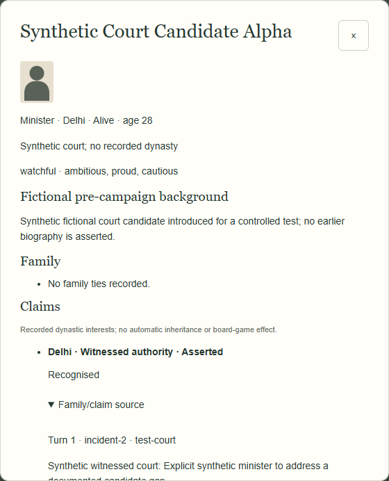

# M2B-2b-1 — small controlled demonstration

**Synthetic technical test data only. No production prose, naming claims, live deaths or generated player campaigns.** Run `node scripts/demo-readiness.mjs demo.json` for the exact [saved evidence](review/character-engine-m2b2b1/demonstration.json).

| Case | Result | Evidence / safeguards |
|---|---|---|
| Original 23 | Every seat needs-documentation; no typed heirs | Actual saved younger-sibling edges; no parent inferred; cast/seats/RNG unchanged |
| Sibling recognition | `heir-delhi` becomes policy-eligible adult | New witnessed synthetic designation by `ruler-delhi`; claim source is `test-court`, not setup; existing sibling history remains |
| Minister | Synthetic Court Candidate Alpha, 28, minister in Delhi; ruler stays | Existing sibling is explicitly exiled in the labelled M1 fixture, so no supported available person is bypassed; witnessed-authority claim; new identity has no inherited kin/dynasty/memory |
| Emergency | Synthetic Emergency Candidate Beta, 32, succeeds under an independently supplied synthetic death warrant | Intro source then linked succession source in one returned state/Undo frame; board unchanged, no vacant seat; former outlook remains private to its original owner |
| Minor | Synthetic child, 12, titular; Synthetic widow, 46, distinct regent | Existing M2B-1 sourced child claim and typed guardian; regent never becomes the ruler automatically |
| Contest | Multiple recognised claims remain inspectable, no winner | Sources/reasons preserved; no name/gender default; no invented feud |
| Company | Court development rejected | 1813 Bengal/Bombay/Madras office/control semantics stay unchanged |
| Active regency | New exit/replacement rejected with intact old tenure | Contract describes missing non-adulthood closure and replacement-tenure model, including documented second-guardian eligibility |
| Foreign claimant | Known claim, cross-region block | Assignment remains unchanged; no hidden transfer or board settlement |

The synthetic vassal test separately introduces a Punjab minister and runs a controlled accession while retaining Delhi as overlord and every board field unchanged. No emperor approval, conquest or treaty is invented.

Actual later New Turn ages the introduced identity by +3 through the existing engine; no birth/recognition/court event is generated. Repeated region/profile selection changes no state. Imported controlled records preserve exact JSON/snapshot/Undo/Redo and protected physical progress. Existing UI background headings remain unchanged; the text explicitly labels the newly introduced profile synthetic rather than asserting a pre-campaign biography.

For quantitative strategy comparisons, read the [analysis](character-engine-m2b2b1-analysis.md). None of its frequencies, cap, naming or rare-event assumptions is approved for live play. See [implementation and unimplemented contracts](character-engine-m2b2b1-implementation.md).
