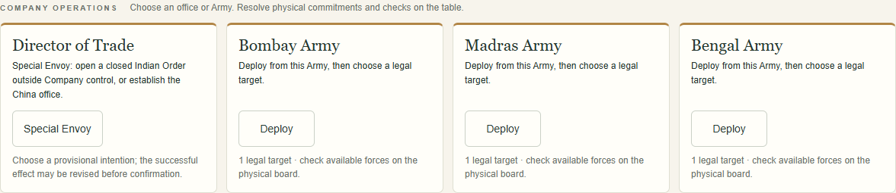
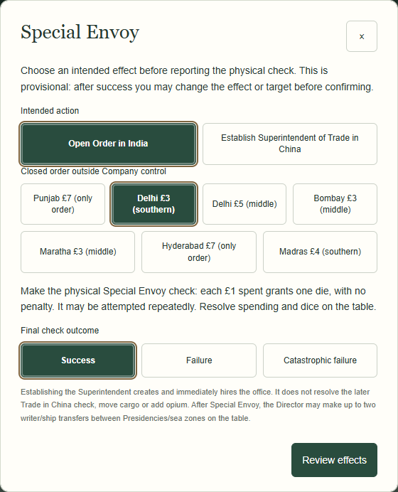

# Collection 09C-1 — Company Operations UI

Implemented 25 October 2026. UI/workflow scope only; no adviser integration or hosted Site deployment.

Implementation commit: `56929d045f70b7a098413cc3887a62b8b52519ee`.

## Delivered behavior

- A stable Company Operations area above the map contains Director of Trade, Bombay Army, Madras Army and Bengal Army, in that order. It uses four columns on desktop, two on tablet, one on narrow screens. Buttons have 48px minimum height and visible unavailable-action reasons.
- Army Deploy starts with the originating Army fixed and legal targets visible. Back/target changes cannot switch the Army. Existing strength breakdown, alliances, commitments, officer losses, one-time loot, outcomes and separate Elephant instruction pages are reused. Unavailable regions have an expandable explanation from the shared legality helper.
- Removed the generic toolbar Deploy, regional Deploy/Special Envoy, and competing generic-menu Special Envoy/Governor entries. Governor Tax and unsuccessful Administer stay attached to the selected Company-controlled region. Debug's explicit test launcher retains the generic Army chooser; regular play always starts from an Army panel.
- Director Special Envoy shows the provisional intended effect and particular eligible closed Order before enabling physical outcome reporting. Success can be revised in the form or via **Change intended effect / target** on review, preserving the reported success. Review regenerates effects from the final choice. Failure opens neither an Order nor China. Attempts remain repeatable. Closing before confirmation leaves no saved draft, history, memory or RNG change.
- China establishment explicitly creates and hires the Superintendent office; it does not perform Trade in China. Existing read-only opium/potential-proceeds information now describes the later separate check, its position after Bengal, per-ship dice, one opportunity and zero-opium prohibition. No actual China outcome is offered or recorded. Existing Envoy to China law/rate logic is retained.
- Under Governor General, the trade panel is labelled Governor General with replacement explanation and disabled Special Envoy. Obsolete Governor controls are absent; existing General checks and regional Tax placements remain available.

## Architecture and preservation

`dist/company-operations.js` is a presentation-only renderer using existing Operations/target legality. `app.js` wires institutional buttons to the existing dialogs. `deploy.js` accepts an optional fixed `army`, skips the chooser for regular institutional launches, and retains the shared resolver. `action-dialogs.js` changes only Envoy planning/revision and menu entry presentation. Help, build notes and turn-guide app directions follow the new entry points; physical rules/instruction text is retained.

No changes to `model.js`, `actions.js`, event/Shuffle rules, 09A projection, narrative engines/catalogues, physical dice resolution, state schema, transactional persistence, or Undo/Redo. No old-save migration. Existing saved wording remains untouched. Revised China plans do not leave a stale Indian Order in their committed input.

## Verification

- `npm test`: **292 passed, 0 failed** (275 baseline plus 17 focused regressions).
- Focused tests cover all three fixed origins, multiple eligible target choices, illegal target injection, back/cancel, all three deployment outcomes against the existing resolver, provisional Envoy ordering, missing/illegal choices, both failure branches, successful branch revision in both directions, single China creation, law replacement, ephemeral outlook previews and narrative-on/off mechanical equivalence without gameplay RNG consumption.
- `scripts/check-operations-browser.cjs`: Chrome **156.0.8078.47**, **1440×900** and **1024×768**, isolated synthetic regular/debug campaigns. All three Army paths; legal target lists and excluded foreign homes; strength/Back/target changes; successful and failed deployments; cancelled previews/reload; Envoy order-to-China revision; failure/repeat/cancel; Company-order exclusion; duplicate office prevention; General replacement; actual current-version export/import, snapshot creation, exact persisted Undo/Redo and debug/regular isolation. No page errors or horizontal workspace/dialog overflow.
- Existing `check-m2-browser.cjs`, `check-outlook-browser.cjs`, and `check-trade-browser.cjs` also pass. They cover protected reveals/rolls/instruction progress, actual Shuffle/public batch, exact outlooks, approved trade callbacks and personal evidence, all four scenarios, saved narrative snapshots/Undo/Redo, and regular/debug isolation. Additional existing-suite viewports: **1440×1000**, **1024×768**, **390×844**. No page errors.
- [Machine-readable verification](collection09c1-verification.json). Review screenshots below were inspected visually; all shown campaigns are synthetic test setups.

## Small UI demonstration

1. **Bombay Army → Deploy → Delhi.** The Army remains Bombay; Delhi's existing empire defence is shown. Back permits choosing another legal target without changing origin or the saved campaign.
2. **Director → Open Order in India → Delhi £3 → Success → Review → Change intended effect → establish China.** Success is retained; confirming creates only the China office. Delhi's Order stays closed. Undo/reload/Redo restores the exact saved campaign and words.
3. **Governor General active.** The first panel states the replacement, Special Envoy is disabled, and Company-region administration uses General Tax rather than an obsolete Governor.

## Limits and deferred work

The existing deployment model resolves **one region per attempt**. Multiple legal alternatives, target revision and subsequent deployments are preserved; no simultaneous multi-region/batch commitment mechanic was introduced. Physical Army availability, money, ships and officeholders remain untracked. Actual Superintendent Trade in China success/failure and finance remain table-only; opium counts reuse existing metadata without asserting a new board audit.

09C-2 counsel, new adviser memories, 09D dialogue placement/callbacks, opium-change commentary and Collection 10 remain deferred. The discarded map-workspace redesign is not included. No hosted Site deployment was performed.
