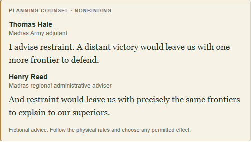
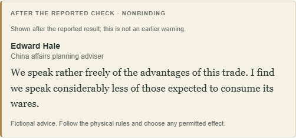

# Collection 09C-2 — Persistent advisers and planning counsel

Implemented 25 October 2026, from approved design/writing. Code/tests commit: `6934df849fd05beaa74bb2197033f7993ccdbb1d`.

## Identity mapping

| Functional institution | Existing person ID | Treatment |
| --- | --- | --- |
| Bombay Army | `army-bombay` | Existing continuing adjutant |
| Madras Army | `army-madras` | Existing continuing adjutant |
| Bengal Army | `army-bengal` | Existing continuing adjutant |
| Director of Trade | `secretary-general` | Existing Arthur Pembroke, also used by legacy Director/General office text; Director counsel only while office exists |
| China affairs | `secretary-bengal` | Existing eastern Presidency secretary; functional China planning responsibility, not a new Superintendent appointment |
| Regional Governor planning | `secretary-{presidency}` | Existing Presidency administrative adviser for the selected Company region |

**No new characters, names, biographies, promotions or permanent relationship attributes.** The existing 23-person cast and its histories are unchanged. Functional IDs are separate from person IDs in `narrative-advisers.js`; displayed planning-role aliases do not overwrite stored positions. The existing General/Bengal profiles, including any original correlations, are retained. Roles do not dictate temperament; all Armies use the same personality predicates and existing campaign-generated traits/voice/confidence. A pure identity/voice-derived aptitude is used for the rare professional exchange, without adding adviser entries to ruler-only 09A aptitude storage. Missing, dead, imprisoned or unavailable advisers remain silent; no substitute inherits their private memories.

## Delivered planning behavior

- Army-specific legal target/force screens show a short relevant approved opinion where eligible. Routine/no-context plans may be silent. Target changes update the preview; numeric force adjustments do not rotate it. Recent military reflection needs the same speaker's owned memory plus a real same-institution deployment fact from the current/previous turn.
- Public danger uses the existing 09A `publicKnowledge` projection and `forecastRegion`, with a real all-Crisis returned batch and the acting Army's actual exposure. Hidden draw faces/order and Shuffle permutations are never used. The rare coherent prudence/glory exchange additionally needs two eligible same-Presidency people and a demonstrable extra frontier; arbitrary opposite quips are not combined.
- Specific Indian Order planning uses the Director contact; proposed China office creation uses the China contact. Eager versus morally uneasy China voices depend on persistent personality, with deliberate silence where neither is suitable. No unverified opium counts, cargo, completed trade or receipts are asserted.
- Special Envoy remains provisional. Revised effects replace stale content and speaker. Advice after a reported result is labelled **AFTER THE REPORTED CHECK**, explicitly not an earlier warning. Failure/catastrophe hides counsel; no accusation that the player rejected advice is introduced.
- Governor actions have an optional **Plan Administer** view. Tax advice is conditional on a legal eventual success effect; the view explicitly leaves the actual post-success choice to the physical rules. Untracked ship/regiment availability is not assumed. Existing result-reporting controls and General replacement are preserved; no new General voice is enabled.

## Contracts and boundaries

`narrative-counsel-content.js` holds exact approved words and explicit deferrals. `narrative-counsel.js` evaluates factual/voice guards and maintains only a transient per-dialog preview cache. Preview objects contain template/person/institution/action/target IDs, stance, exact text, public evidence and UI temporal role. They are **never attached to action input, incident, saved scene, character or history**. No committed-advice ledger, prediction memory or callback infrastructure was added. That explicit final 09C-2 scope supersedes the earlier forward-looking 09D recording sections of the design.

`deploy.js`, `action-dialogs.js` and `company-operations.js` only render/wire these views; `narrative.css` supplies a restrained quote style. The physical resolver, rules/probabilities, event/Shuffle mechanics, 09A/09B functions, cast generation, narrative RNG, saved wording, save schema and transactional Undo/Redo are unchanged. No migration or new runtime service/dependency. Existing current-schema campaigns gain computed functional associations without any backfill or byte-changing read. New preview IDs do not enter the chronicle or become future warnings.

## Dialogue availability

**17 selectable authored units / 18 spoken lines; 30 units withheld or implementation-deferred**, including the approved 09D catalogue. See the [complete IDs and reasons](collection09c2-dialogue-status.md). This includes conservative withholding of relative-Army-strength claims, unverified opium-dependent passages, unavailable Governor effects and all new post-action/outcome material. No authored words were rewritten to avoid a missing guard.

## Verification

- **315 tests passed, 0 failed** (`npm test`; prior baseline 292). Twenty-three focused additions cover exact wording/counts, four-scenario identity/save preservation, personality variants, legal/illegal targets, grounded frontier/danger/experience guards, intact paired eligibility, hidden-permutation equivalence, stable/cancelled previews, post-success revision, Governor limitations, owned memory, Commander dismissal, no saved counsel/RNG effects and Undo/Redo. Existing narrative-on/off equivalence and 09A hidden-information regressions also pass.
- New `scripts/check-counsel-browser.cjs`: isolated synthetic regular/debug campaigns at **1440×900** and **1024×768**, Chrome **156.0.8078.47**. Passed stable repeated/numeric/target previews; real conquest and dedicated Elephant pages; exact persisted Undo/Redo; correct post-report Envoy switch; failure/cancellation; optional Governor planning; rare exchange after actual Shuffle/phase/Parliament/New Turn resolvers; unchanged pre-09C-2 current-schema save import; and regular/debug storage parity. No page errors or horizontal dialog/page overflow. Review screenshots were visually inspected.
- Existing Operations, M2, outlook/actual-Shuffle and trade browser suites pass, covering success/failure, current saves/export/import/snapshots, old saved words, protected reveals/rolls and all scenarios. Additional existing-suite viewports: **1440×1000**, **1024×768**, **390×844**. One concurrent trade-suite startup timed out; its isolated rerun passed without source changes. No unresolved browser failure.
- [Machine-readable verification](collection09c2-verification.json). [Small reproducible creative-review demonstration](collection09c2-demo.md), generated with `node scripts/export-counsel-demo.mjs` from explicit synthetic profiles and actual production selection.

## Remaining limitations

The app still lacks a verified printed opium-map audit and stable total Army inventory/relative-force assessment. Governor reporting models Tax and unsuccessful Administer, not all successful ship/regiment effects; those options remain physical. These gaps are documented rather than filled with invented facts. China has only the eligible eager/uneasy planning variants for now; bureaucratic outcome lines remain deferred. Preview cooldowns/history, saved recommendations, followed/overruled claims, new outcome memories, 09D relocation/callbacks, opium-delta commentary and Collection 10 are not implemented. The discarded map redesign is not reintroduced.

Exact authored words are approved. Integrated voice selection, pacing and personality interpretation still await user/ChatGPT creative review. Changes are committed/pushed to main; **the hosted Site is not deployed**.
