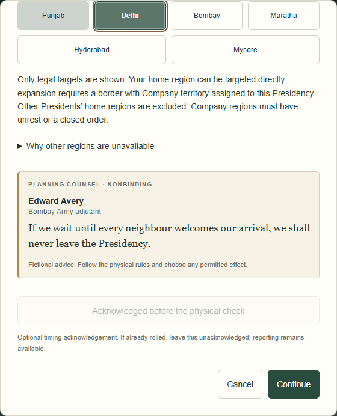
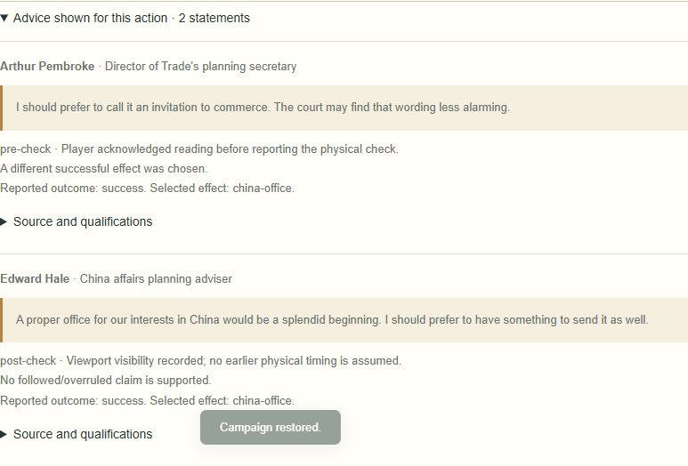

# Collection 09D-1 — committed advice and immediate outcome reactions

Implemented 25 October 2026 on the accepted 09C-2 baseline (`d0b65e3`, pulled before editing). Scope is 09D-1 only. Implementation commit: `68b858a2cb1105e0968a1f3b7a49fab5d069af8e`. The following documentation commit contains this report, the small demonstration and verification record; obtain its hash with `git log -1 -- docs/narrative/collection09d1-implementation.md` (a commit cannot contain its own hash).

## Lifecycle and timing

09C-2 previews are still deterministic and ephemeral. A dialog-local observer verifies the rendered speaker and exact quote, then records actual viewport visibility. This is insufficient to prove physical-roll timing: players can open an action after rolling. The optional **I read this before the physical check** button therefore supplies explicit player attestation. It is never required to proceed and disappears after reporting. It does not validate or change the physical check.

| Action | Advice display | Report boundary | Authoritative commit |
| --- | --- | --- | --- |
| Deploy | Actual selected Army/target, target and force pages | First reported final physical outcome | Final Confirm & apply, after losses and separate Elephant instructions |
| Special Envoy | Provisional intended effect/Indian order | First reported physical outcome freezes the original intention | Final Confirm & apply after the legally revisable successful effect |
| Governor | Optional Plan Administer, existing regional assistant | Actual Tax or Unsuccessful Administer reporting button | Final Confirm & apply of the supported resolver result |

Acknowledged words before that boundary are `pre-check`; merely visible earlier words are `pre-commit` with unknown physical timing; newly shown words after it are `post-check`. Back/reopening within an attempt cannot upgrade later speech to earlier advice. Re-reporting a corrected outcome changes the result, not the initial temporal boundary. Earlier exploratory plans are discarded when reporting; abandoned Deploy targets are discarded before binding. A paired exchange commits only when both exact statements were delivered. Cancellation saves nothing.

An Indian recommendation genuinely acknowledged before a successful Envoy check survives a later China choice. A China comment displayed afterwards remains post-check. Failed flexible checks have `no-choice-on-failure`, never an ignored recommendation. Conditional caution is not opposition, and qualified support does not become a promise of victory.

The existing protected progress store accepts revealed events and saved app dice, not unconfirmed Deploy/Envoy/Governor physical reports. This remains unchanged: closing/reloading those uncommitted dialogs discards their ephemeral advice and attempt. Existing protected pending events, physical-instruction acknowledgement cursors and saved dice retain their original resume behavior.

## Storage and integration

- Reuse `narrative.statements`: additive `type: advice` records preserve character ID/name, functional institution/role, exact approved text and template/line index, exchange unit, Army/targets, plan, stance, explicitly quoted reservations, confidence tone, temporal phase/provenance, actual incident/outcome/effect and followed status. The original numerical confidence and traits are retained in the historical speaker observation. Optional interpretation points to the immediate subjective response; there is no correctness score.
- `history[].narrative.advice` links statement IDs to the existing committed incident and stores the report boundary and one public observation: board, 09A public projection and the actual speakers. Keeping this observation is necessary because later debug setup edits are not reversible canonical incidents and must not change historical eligibility. It contains no hidden tile order/faces, physical dice, player identities or untracked inventory.
- An opaque WeakMap carries observations on the actual resolver result; only the normal narrative commit writes them. No separate gameplay action log, generated preview history, rivalry/relationship counters or new personal memories are created. No cast or biographies changed.
- Immediate exact responses become ordinary saved scene lines linked back to the advice. Standard rendering remains chronicler plus at most two reactions; additional existing saved voices are expandable. Original quotations and provenance are inspectable in scenes, adviser dossiers and readable chronicles. No action-dialog relocation.
- Validation checks original wording, original speaker/institution, public factual eligibility, target, sequence, canonical outcome, statement/response links, intact pairs and audiences. A failed Envoy can have no regional facts: its authoritative input/result and committed incident establish failure; no court rejection or fictitious trade fact is added. Opening China is validated as office creation, never commerce.
- Both statements and scenes travel in the existing atomic transaction, save/export/import/snapshot and Undo/Redo frames. Previously saved dialogue stays unchanged. Current-schema saves without advice metadata are accepted unchanged and never backfilled. No old-save migration or schema-version bump.
- Commit runs after existing narrative selection/outlook updates, preserving the old narrative RNG stream and 09A/09B behavior. Advice is excluded from existing recurring callback/relationship-cause paths; 09D-3 is not silently enabled. The only dependency adjustment is a lazy lookup of existing printed Order ownership in counsel to avoid a model/actions initialization cycle; no ownership/rules change.

## Exact dialogue availability

**15 of 18 new 09D-1 lines are eligible**, alongside **12 previously approved applicable outcome lines**: **27 enabled result entries** total. Existing **17 preview units / 18 spoken lines** remain unchanged. Personality affects deterministic response preference only after all factual/timing guards. Eligibility does not guarantee a particular entry will win selection in every campaign.

New enabled IDs:

- `09D1-deploy-discouraged-victory-professional`, `09D1-deploy-discouraged-victory-vain`, `09D1-deploy-discouraged-failure-relieved`, `09D1-deploy-discouraged-catastrophe-sober`.
- `09D1-deploy-supported-victory-ambitious`, `09D1-deploy-supported-failure-defensive`, `09D1-deploy-supported-catastrophe-humbled`.
- `09D1-envoy-success-india`, `09D1-envoy-failed-india`, `09D1-envoy-success-china`, `09D1-envoy-failed-china`, `09D1-envoy-chose-china-after-india`, `09D1-envoy-chose-india-after-china`.
- `09D1-governor-tax-followed`, `09D1-governor-check-failed`.

Prior result IDs now eligible when their own prerequisites hold:

`09C-envoy-india-success`, `09C-envoy-india-failure`, `09C-china-office-created`, `09C-china-office-failure`, `09D-envoy-switched-to-china`, `09D-envoy-switched-to-india`, `09D-governor-followed`, `09D-governor-check-failed`, `09D-warning-success`, `09D-warning-failure`, `09D-advocate-success`, `09D-advocate-failure`.

Withheld new IDs:

| ID | Missing prerequisite |
| --- | --- |
| `09D1-governor-tax-overruled` | Actual successful Regiment/Ship/different effect is not represented |
| `09D1-governor-regiment-overruled` | Genuine eligible regiment recommendation and verified different successful effect |
| `09D1-governor-ship-followed` | Genuine ship recommendation, ship availability and verified Ship success effect |

Prior `09D-governor-overruled` remains withheld for the same effect/evidence gap. `09D-callback-later-crisis` is 09D-3. Unavailable relative-Army-strength, audited-opium and other previously withheld 09C previews remain withheld; no factual guards were relaxed. Governor General law suppresses obsolete Director/Governor counsel.

## Verification and review

- **339 automated tests pass, 0 fail** (`npm test`; baseline 315). Twenty-four new tests cover exact wording/counts, all Army outcome/stance combinations, qualification preservation, two speakers, invisible/cancelled/post-report/changed-target cases, both Envoy switch directions and failures, supported Governor outcomes, idempotency, persistence/Undo/Redo, old current-schema campaigns, hidden permutations, narrative-on/off mechanical/RNG equivalence, tampered evidence and later debug/General changes.
- New regular/debug browser suite at **1440×900** and **1024×768**, Chrome **156.0.8078.47**: acknowledged and unknown timing, exact committed success/failure/catastrophe reactions, paired exchange, cancellation/target changes, post-success Envoy revision, Governor Tax/failure, reload/Undo/Redo, JSON export/import, real snapshot restore and readable chronicle. No page errors or horizontal page/dialog overflow. Screenshots visually inspected.
- Existing counsel, Operations, M2, outlook/actual-Shuffle and trade browser suites pass. These preserve all three Army launch paths, physical instructions, legal targets, current saves, protected reveal/roll/instruction progress, regular/debug separation, prior callbacks and outlooks. Additional existing-suite viewports: **1440×1000**, **390×844**.
- Browser test development initially attempted to reopen Delhi after conquest and an Army after catastrophe; those are correctly unavailable. The test was corrected to respect actual legal state. Final suites pass without bypassing disabled controls.
- [Small reproducible demonstration](collection09d1-demo.md): support/victory, warning/catastrophe, pre-check India to post-check China, and an attractive earlier-prediction response correctly withheld for uncertain timing. Recreate with `node scripts/export-advice-demo.mjs`. Synthetic profiles, manual physical result inputs and timing attestations are explicitly labelled. [Verification record](collection09d1-verification.json).

## Limits and later work

Physical pre-check timing relies on explicit player attestation; automatic visibility cannot prove when a table roll occurred. No attestation means no retrospective Deploy warning/support or followed/overruled claim. Some eligible routine actions may have no advice-linked response. Scene placement remains as before for 09D-2. Long-term reputations, selective recollection, rivalries and recurring advice callbacks remain 09D-3. Governor Regiment/Ship outcomes, China shipments/proceeds and total Army inventory are still untracked. No new characters, fictional text, mechanics, portraits, migrations or hosted Site deployment.

Authored wording is approved; passing tests establishes technical integration, **not final creative acceptance** of selection/pacing. User and ChatGPT retain that review.
