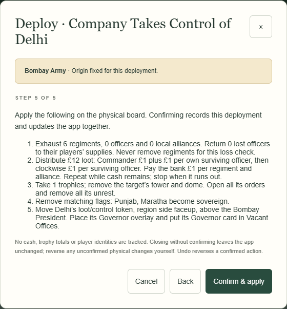
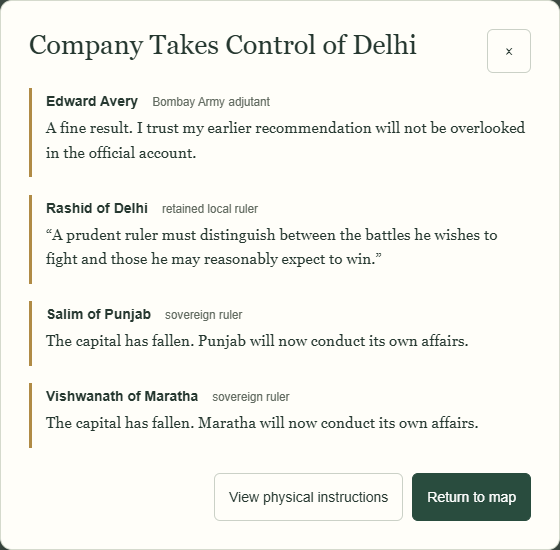
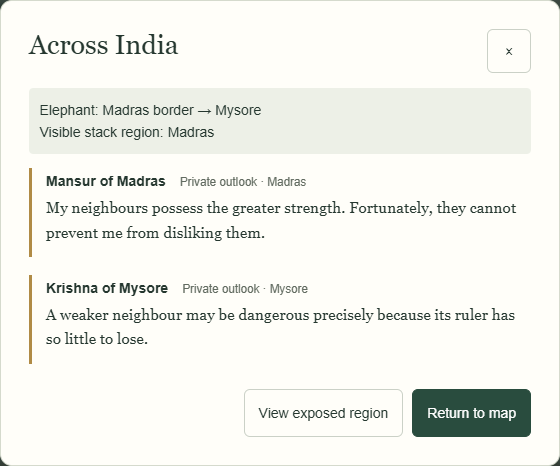

# Collection 09D-2 — small application demonstration

26 October 2026. Synthetic campaign/personality setups; physical check results are explicit test inputs. All actions below run through the real browser application and gameplay resolvers. This is integration review, not creative acceptance.

## Same Deploy, two modes

Both instruction pages have the same factual result: **Company Takes Control of Delhi**. The browser test compares their entire rendered physical page text for equality. Normal mode ends after the existing Confirm & apply. Narrative mode then shows this separate single scrollable scene:

Edward Avery
Bombay Army adjutant

A fine result. I trust my earlier recommendation will not be overlooked in the official account.

Rashid of Delhi
retained local ruler

“A prudent ruler must distinguish between the battles he wishes to fight and those he may reasonably expect to win.”

Salim of Punjab
sovereign ruler

The capital has fallen. Punjab will now conduct its own affairs.

Vishwanath of Maratha
sovereign ruler

The capital has fallen. Maratha will now conduct its own affairs.

The exact original advice and all archived reactions remain in the campaign record. The active scene prefers the committed adviser response to the same person’s older generic reaction; it does not rewrite either. Back to physical instructions, including separate Elephant pages where applicable, then Return to scene leaves saved bytes unchanged.

## One event, anticipation, then the next event

### Event 1: mysore-peace

Existing selected scene:

Chronicler
Anonymous narrator

India event · Peace. Delhi: 2 tower levels, 0 unrest; 1 disrupted commercial opportunities. Maratha: 3 tower levels, 0 unrest; 1 disrupted commercial opportunities.

Physical pre-movement/movement instruction pages displayed: 2. Newly public stack region: **Madras**. The following tile’s face is not used or shown by anticipation.

Separate anticipation page:

Across India
×

Elephant: Madras border → Mysore
Visible stack region: Madras

Mansur of Madras
Private outlook · Madras

My neighbours possess the greater strength. Fortunately, they cannot prevent me from disliking them.

Krishna of Mysore
Private outlook · Mysore

A weaker neighbour may be dangerous precisely because its ruler has so little to lose.

### Event 2: madras-windfall

Existing selected scene:

Chronicler
Anonymous narrator

India event · Windfall.

Physical pre-movement/movement instruction pages displayed: 0. Newly public stack region: **Delhi**. The following tile’s face is not used or shown by anticipation.

Separate anticipation page:

Across India
×

Elephant: Madras border → Mysore
Visible stack region: Delhi

Mansur of Madras
Private outlook · Madras

My neighbours possess the greater strength. Fortunately, they cannot prevent me from disliking them.

Krishna of Mysore
Private outlook · Mysore

A weaker neighbour may be dangerous precisely because its ruler has so little to lose.

Rashid of Delhi
Private outlook · Delhi

A closed road can quiet a market without settling a single argument.

The trace preserves distinct Elephant and visible-stack positions. “Private outlook” is intentional: these are exact already-saved 09B thoughts, not public statements or knowledge other advisers can quote. Anticipation is stored as private presentation metadata on the parent event; no new memory, public speech or future-event forecast is generated by reading the page.

The browser run reloads protected progress before each commit, revisits instructions and public-region pages, and checks exact saved-state stability. The phase recap lists completed parent events instead of replaying their conversations. Full history and exact scenes remain available after JSON export/import; modal page/scroll position itself remains transient.
