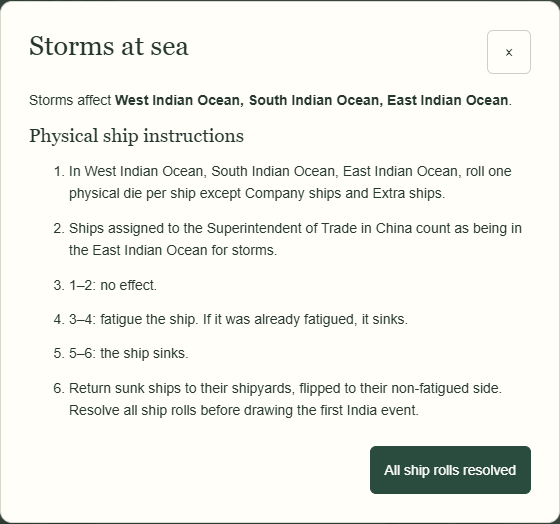
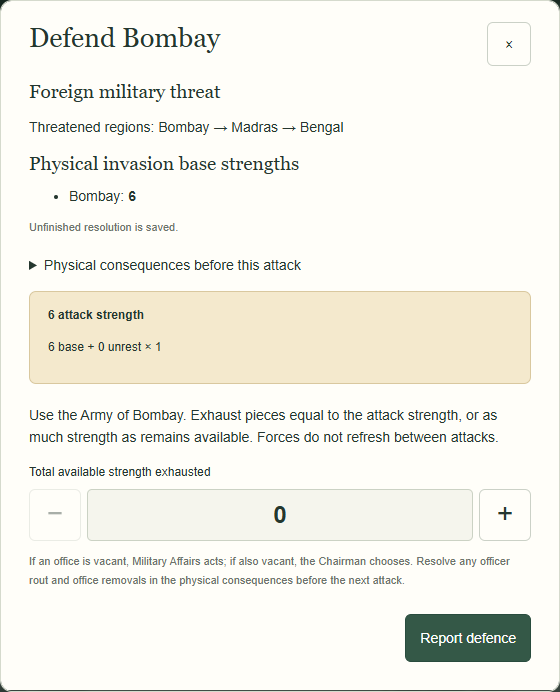
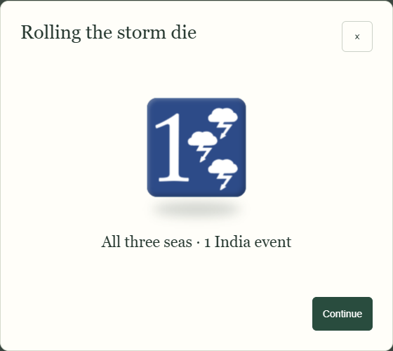

# Staged storms and invasions — small browser demonstration

26 October 2026. These are isolated synthetic campaigns with explicit test RNG sequences, exercised through actual application workflows. They demonstrate presentation and saved outcomes, not creative acceptance of unapproved prose.

## 1. Narrative weather before the count

The controlled initial value is face 3 (all three seas). The application saves it once. It first shows only the affected seas and physical shipping instructions; neither this page nor the workspace/archive discloses the event total. Closing/reloading returns to the same weather without another random call.

## 2. The same result, disclosed later

After the player completes the real physical ship procedure and uses the existing All ship rolls resolved control, a separate factual page reveals **1 India event**. It uses the same face; no second draw occurs. Calm faces instead show calm seas and a navigation-only Continue, with no ship-resolution task, before revealing 4 events.

Atmospheric storm/tension prose is not approved yet, so these pages intentionally use factual UI rather than a character saying how many game events will occur. No specific ship loss is inferred.

## 3. Several threatened regions; strength at its actual point

A separate controlled invasion face 3 produces the actual sequence **Bombay → Madras → Bengal**. The first legal strength result is **6**. At this screenshot, later strengths do not yet exist and are not shown. The next two test values become **3** and **5**, only after the preceding physical defence report. The same procedure is checked for failed War Against France.

There is no graphical storm die, graphical strength die or extra Roll acknowledgement. Exact physical attack values remain clear. Reload, JSON import/export and snapshot restoration preserve the pending target and result; they do not draw again. Named invaders, troop headcounts, losses and the literary assertion “overwhelming army” are withheld pending approved context-sensitive writing. This is the factual fallback for the large-force demonstration.

No-storm behavior remains distinct: Foreign Invasion attacks the actual exposed region; failed War Against France has no invasion targets. Physical rout and Elephant redirects remain required where the actual result triggers them.

## 4. Normal mode stays as before

The same all-seas phase result still uses the existing graphical die and simultaneously shows the event count. The physical/manual initial storm option remains available. Normal invasion strengths remain automatic with their original graphics; no manual invasion-strength feature was added.

Both **1440×900** and **1024×768**, regular and Debug, pass the dedicated browser checks. Mechanical instructions and actual results remain authoritative. These new factual pages are not a newly approved dialogue collection.
