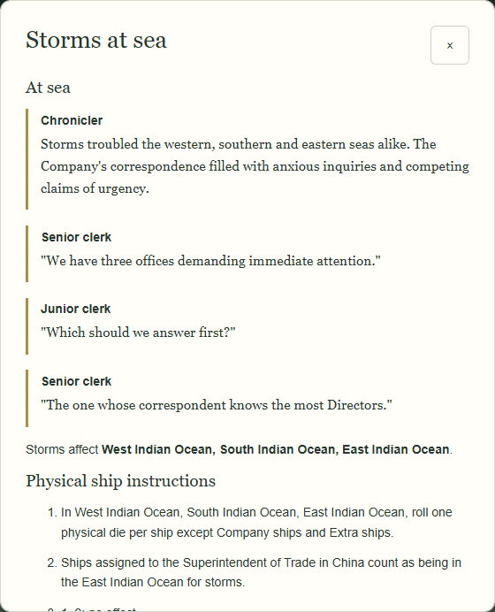
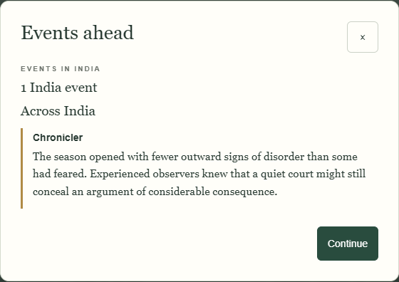
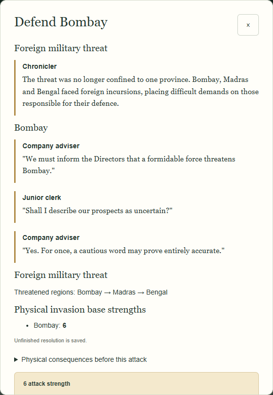

# Collection 09E — small application demonstration

Generated with `node scripts/check-09e-browser.cjs` against an isolated local app. Synthetic campaign, existing cast, no personal save. The invasion is an explicitly **manually triggered test event**, using the real action resolver and valid reported defences. Test-controlled random results make this reproducible; prose is the approved catalogue, not generated writing.

## Revised automatic flow: weather, then tensions

Actual saved initial face: **3**, storms in all three seas, one India event. Before the existing ship-resolution boundary the event count is concealed in the workspace and archive. The weather scene appears **automatically first**, above unchanged physical ship instructions on the same scrollable page. There is no Read scene button or narration-only Continue; the player uses the existing **All ship rolls resolved** control.

**09E-A-01**, evidence `{"face": 3}`

**Chronicler:** Storms troubled the western, southern and eastern seas alike. The Company's correspondence filled with anxious inquiries and competing claims of urgency.

**Senior clerk:** "We have three offices demanding immediate attention."

**Junior clerk:** "Which should we answer first?"

**Senior clerk:** "The one whose correspondent knows the most Directors."

After reporting all ship rolls resolved, the count-reveal page shows **1 India event** and this contrasting sober scene:

**09E-T1-03**, evidence `{"count": 1}`

**Chronicler:** The season opened with fewer outward signs of disorder than some had feared. Experienced observers knew that a quiet court might still conceal an argument of considerable consequence.

## Revised automatic flow: three actual invasion targets

The test event targets Bombay → Madras → Bengal. Each raw strength is generated and saved at its own resolver boundary: **6, 3, 5** respectively. The physical UI retains the exact attack calculation and legal Army. This does not establish troop counts, casualties, identities or victory. The first defence page automatically begins with announcement and Bombay appraisal; later targets automatically begin with their own new appraisal before the same required defence report. No separate narration step is added. All four records remain in the archive.

**09E-F-08**, evidence `{"companyTargets": ["bombay", "madras", "bengal"], "courts": {"bengal": "ruler-bengal", "bombay": "ruler-bombay", "madras": "ruler-madras"}, "governorGeneral": false, "targets": ["bombay", "madras", "bengal"], "type": "foreign"}`

**Chronicler:** The threat was no longer confined to one province. Bombay, Madras and Bengal faced foreign incursions, placing difficult demands on those responsible for their defence.

**09E-H-05**, evidence `{"companyTargets": ["bombay", "madras", "bengal"], "courts": {"bengal": "ruler-bengal", "bombay": "ruler-bombay", "madras": "ruler-madras"}, "governorGeneral": false, "raw": 6, "region": "bombay", "targets": ["bombay", "madras", "bengal"], "type": "foreign"}`

**Company adviser:** "We must inform the Directors that a formidable force threatens Bombay."

**Junior clerk:** "Shall I describe our prospects as uncertain?"

**Company adviser:** "Yes. For once, a cautious word may prove entirely accurate."

**09E-M-05**, evidence `{"companyTargets": ["bombay", "madras", "bengal"], "courts": {"bengal": "ruler-bengal", "bombay": "ruler-bombay", "madras": "ruler-madras"}, "governorGeneral": false, "raw": 3, "region": "madras", "targets": ["bombay", "madras", "bengal"], "type": "foreign"}`

**Chronicler:** The foreign expedition assembled against Madras was not one to be brushed aside. Its eventual success remained uncertain, as did the wisdom of several confident pronouncements made in advance.

**09E-H-03**, evidence `{"companyTargets": ["bombay", "madras", "bengal"], "courts": {"bengal": "ruler-bengal", "bombay": "ruler-bombay", "madras": "ruler-madras"}, "governorGeneral": false, "raw": 5, "region": "bengal", "targets": ["bombay", "madras", "bengal"], "type": "foreign"}`

**Local courtier:** "The invaders have brought great strength against us."

**Experienced counsellor:** "Then His Highness will need courage, prudence and fewer courtiers telling him only what he wishes to hear."

## Persistence evidence and editorial limits

Browser assertions compare every saved scene object and rendered word across close/reopen and reload, JSON export/import, snapshot restore and committed Undo/Redo. Scrolling between scene and physical instructions consumes no additional random values. Reopening/reloading resumes the physical page without replaying the already presented scene. The committed parent contains exactly four stage records and the original 23 cast identities. `selected-scenes.json` preserves the supporting contexts and exact words.

An actual three-turn resolver test repeats the same weather family and verifies no immediate template repetition, retained history and exact save/load. All 81 alternatives are reachable across eligible campaign seeds. The sole approved no-invasion scene, N-01, necessarily repeats if that result recurs. Theme/rhythm penalties reduce adjacent joke repetition; they cannot guarantee literary variety in every campaign. These examples demonstrate integration, not final creative acceptance of selection and pacing.

## Click/pacing demonstration

- **Storm:** Begin Events in India → automatic full weather scene → scroll to physical ship instructions → existing All ship rolls resolved → automatic count/tensions page → existing Continue. Calm uses its existing Continue instead of a ship report.
- **Company defence:** actual target face and first raw strength saved → automatic announcement + appraisal above the existing physical defence form → Report defence and required consequences → next saved target's appraisal above its required form. No narration-only click.
- **Indian targets / France with no invasion:** scenes appear on existing physical/review pages; the application does not invent a defence report merely to make space for writing.
- **Close/reload or Undo/Redo:** selected words stay identical; already presented scenes do not replay automatically. Physical reports, Elephant movements and confirmation remain mandatory.
- **Normal / quiet:** no new fictional scene. Existing dice/manual controls and physical procedures are retained.

The browser demonstration uses the same approved text and saved supporting evidence above. Screenshots now show automatic scene-first pages, not optional reading dialogs.
